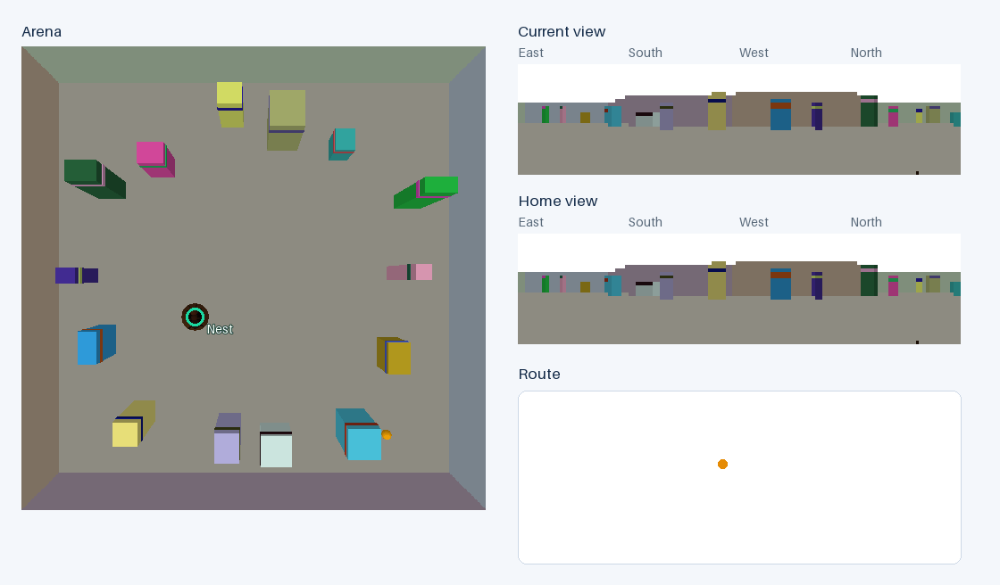

# AntBrain

A research simulation for learned visual memory and local homing.



[Arena overview](docs/assets/arena.png) · [Evaluator trajectory](docs/assets/trajectory.png)

## Quick start

Requires Linux x86-64 (validated platform), [uv](https://docs.astral.sh/uv/getting-started/installation/), and network access for the first installation. Python 3.11 and dependencies are pinned through `.python-version` and `uv.lock`.

```bash
git clone https://github.com/Mikop22/AntBrain.git
cd AntBrain
bash scripts/bootstrap.sh
.venv/bin/python -m pytest
bash scripts/smoke.sh artifacts/first-run
```


