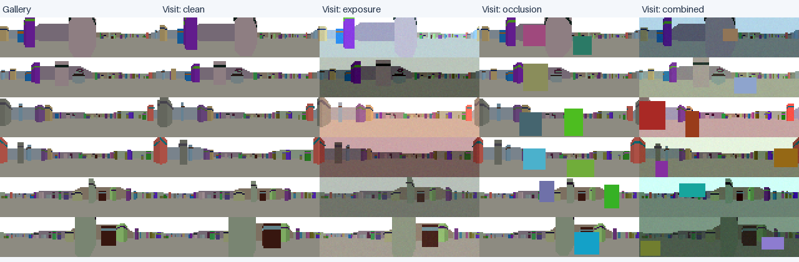

# Level 1 visual-memory models

Level 1 evaluated visual place recognition and unfamiliar-place rejection across 44 disjoint procedural scenes (24 train, 8 validation, 12 test; 48 reference places per scene) under `clean`, `exposure`, `occlusion`, and `combined` sensor conditions.



## Final retained models

Two models are retained for Level 2 local-homing experiments and tracked in [`models/level1/manifest.json`](../../models/level1/manifest.json):

| Model | Params | Cache / Ref | Recall@1 | Recall@5 | Familiarity AUROC | Unfamiliar FPR | Familiar TPR | Latency |
| --- | ---: | ---: | ---: | ---: | ---: | ---: | ---: | ---: |
| **InfoNCE CNN** | 42,728 | 256 B | 96.21% ± 0.25 | 100.00% | **0.989** | **6.25%** | 95.37% | 0.70 ms |
| **Normalized Pixels** | 0 | 49,152 B | **98.87%** | 99.87% | 0.866 | 48.61% | 94.70% | 0.07 ms |

* **InfoNCE CNN (`ant_homing.level1.infonce`):** 3-layer strided conv encoder with $(2, 8)$ spatial pooling and unit-normalized 64D descriptors trained with symmetric paired InfoNCE ($\tau = 0.1$). Selected for compact memory and strong unfamiliar-place rejection.
* **Normalized Pixels (`ant_homing.level1.pixels`):** Per-image z-score normalized RGB baseline. Selected as the non-learned reference for fine-scale retrieval near familiar locations.
* **Discarded candidates:** Raw pixels (fails under exposure shifts) and Multi-Similarity / Conv-AP variants (higher unfamiliar false acceptance and larger footprint than InfoNCE).

## Saved checkpoints

| Seed | Checkpoint | Selected Epoch | Validation Threshold ($d^2$) |
| ---: | --- | ---: | ---: |
| 0 | `models/level1/infonce-seed-0.pt` | 16 | `0.5958` |
| 1 | `models/level1/infonce-seed-1.pt` | 20 | `0.5635` |
| 2 | `models/level1/infonce-seed-2.pt` | 15 | `0.5671` |

Normalized-pixel validation threshold ($d^2$ over 12,288 channels): `9903.92` (`0.8060` mean squared difference).

## Loading for Level 2 experiments

```python
from ant_homing.level1 import infonce, pixels
from ant_homing.simulation import Arena, SimConfig

# 1. Load a frozen InfoNCE model and its calibrated threshold
model, info = infonce.load_checkpoint(seed=0)
threshold = info["threshold"]

# 2. Score two RGB observations (32x128x3 uint8) for homing
infonce_scorer = infonce.load_image_scorer(seed=0)
pixel_scorer = pixels.normalized_image_distance

with Arena(SimConfig(seed=300)) as arena:
    home_rgb = arena.observe().rgb
    d_infonce = infonce_scorer(home_rgb, home_rgb)
    d_pixels = pixel_scorer(home_rgb, home_rgb)
```

## Reproducing training and evaluation from scratch

```bash
.venv/bin/python -c 'from ant_homing.level1.data import generate_dataset; generate_dataset("artifacts/level1/data")'
.venv/bin/python -m ant_homing.level1.experiment train --data artifacts/level1/data --output artifacts/level1/training
.venv/bin/python -m ant_homing.level1.experiment evaluate --data artifacts/level1/data --run-dir artifacts/level1/training --output artifacts/level1/evaluation
```
