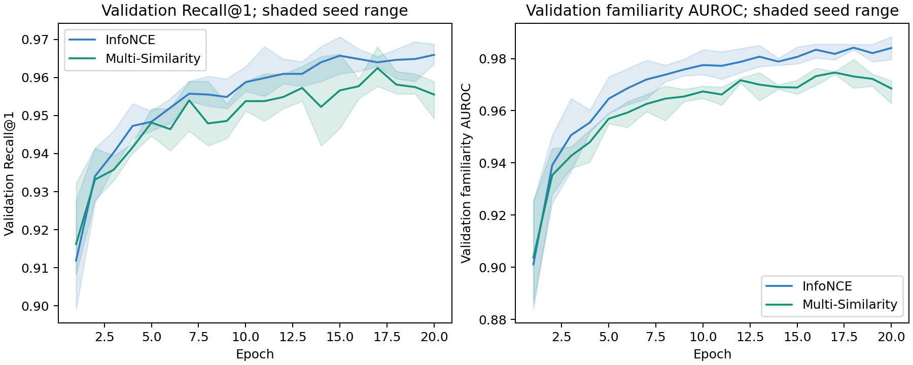

# Matched-encoder loss results

Both arms use the same 42,728-parameter CNN and 64D normalized descriptors (256 bytes/reference), identical initialization within seed, training/validation data, batches, optimizer and 20-epoch budget. Only the loss recipe changes. All three independent reviews passed before optimization; six checkpoints and validation thresholds were frozen before fresh-test scoring.

| Loss | Recall@1 | Recall@5 | Familiarity AUROC | Unfamiliar false acceptance | Familiar acceptance | Correct and accepted |
| --- | ---: | ---: | ---: | ---: | ---: | ---: |
| InfoNCE | 96.77% ± 0.18 | 99.97% | 0.983 | 8.22% ± 1.22 | 94.78% | 92.56% |
| Multi-Similarity | 96.40% ± 0.38 | 99.81% | 0.974 | 13.43% ± 2.03 | 94.81% | 92.71% |

Means are over seeds 0, 1, 2; ± is sample SD in percentage points, not a confidence interval. Thresholds target 95% familiar acceptance on validation; actual test acceptance is measured. Retrieval uses 0.25 m tolerance and excludes unfamiliar queries. Correct-and-accepted is the fraction of familiar queries both correctly localized and accepted.

## Localization

| Loss | Exact place accuracy | Median error | 90th-percentile error |
| --- | ---: | ---: | ---: |
| InfoNCE | 96.77% | 0.120 m | 0.188 m |
| Multi-Similarity | 96.40% | 0.120 m | 0.188 m |

Error quantiles are computed per run and then averaged; they are not pooled across repeated seed predictions.

## Individual runs

| Loss | Seed | Selected epoch | Recall@1 | AUROC | Unfamiliar false acceptance | Familiar acceptance |
| --- | ---: | ---: | ---: | ---: | ---: | ---: |
| InfoNCE | 0 | 16 | 96.96% | 0.984 | 9.38% | 94.49% |
| Multi-Similarity | 0 | 17 | 96.83% | 0.974 | 11.11% | 94.88% |
| InfoNCE | 1 | 20 | 96.61% | 0.984 | 6.94% | 95.14% |
| Multi-Similarity | 1 | 16 | 96.22% | 0.974 | 14.93% | 95.31% |
| InfoNCE | 2 | 15 | 96.74% | 0.980 | 8.33% | 94.70% |
| Multi-Similarity | 2 | 17 | 96.14% | 0.973 | 14.24% | 94.23% |

## Paired scene differences

| Metric | MS minus InfoNCE | 95% paired scene interval |
| --- | ---: | ---: |
| recall at 1 | -0.3762 pp | [-0.8102, +0.0727] pp |
| unfamiliar false acceptance | +5.2083 pp | [+2.6620, +7.8704] pp |
| familiar acceptance | +0.0289 pp | [-0.5353, +0.5208] pp |
| Mean scene AUROC | -0.0086 | [-0.0108, -0.0062] |

paired scene means conditional on three training seeds; AUROC interval is for mean scene AUROC, not pooled AUROC. AUROC in the first table is pooled across queries within each run; the paired AUROC interval above concerns scene means. These are different estimands.

## Conditions

| Condition | InfoNCE false acceptance | MS false acceptance | InfoNCE Recall@1 | MS Recall@1 |
| --- | ---: | ---: | ---: | ---: |
| clean | 13.43% | 20.83% | 98.03% | 97.80% |
| combined | 3.24% | 6.48% | 95.95% | 94.39% |
| exposure | 6.48% | 13.89% | 97.05% | 97.57% |
| occlusion | 9.72% | 12.50% | 96.06% | 95.83% |

## Scope

Training and validation arrays match the pilot exactly. Test seeds 400–411 are fresh: 12 scenes, 576 references, 2,304 familiar queries, 288 unfamiliar queries. Both arms see the same archive. Ideal compass alignment, known scene membership, one procedural scene family and synthetic sensor conditions limit generalization. Homing is not evaluated.

This compares the original paired InfoNCE recipe with mined Multi-Similarity on the same encoder. Positive-pair handling and mining belong to the changed recipe. There is no per-loss tuning; results describe this common optimization budget, not the best attainable performance of either loss. No test-based retuning was performed.

See [protocol](../PROTOCOL.md), [pre-training reviews](../reviews/), and [assessment](../ASSESSMENT.md). Full query results and weights are generated artifacts; tracked fingerprints identify them.

