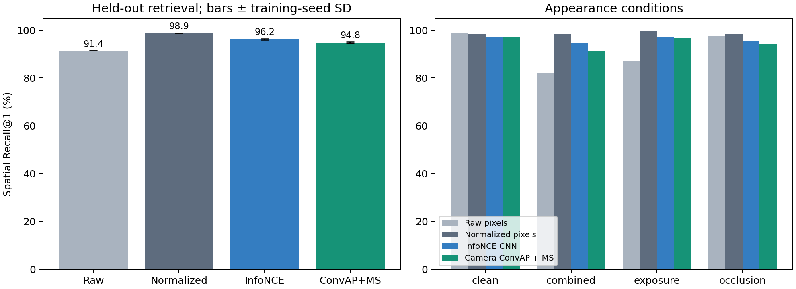
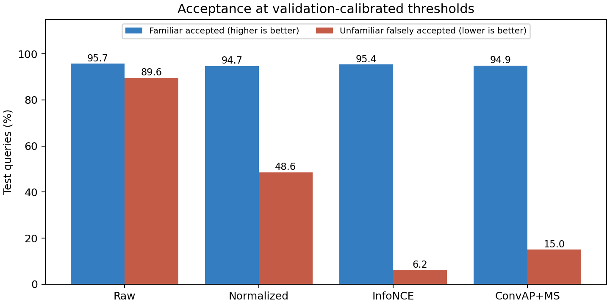
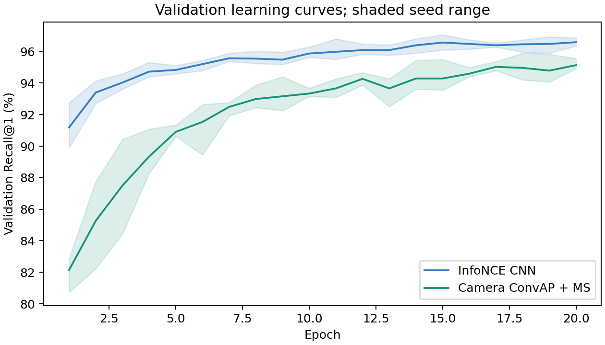

# Level 1 held-out comparison

Three approach groups were built independently and reviewed by three independent agents before optimization. Raw and normalized pixels are two variants of the first group.

## Results

| Approach | Recall@1 | Recall@5 | Familiarity AUROC | Novel false acceptance | Known acceptance | CPU encoding | Model weights | Cache/reference |
| --- | ---: | ---: | ---: | ---: | ---: | ---: | ---: | ---: |
| Raw pixels | 91.45% | 95.57% | 0.781 | 89.58% | 95.75% | 0.013 ms | 0.0 KiB | 49,152 B |
| Normalized pixels | 98.87% | 99.87% | 0.866 | 48.61% | 94.70% | 0.066 ms | 0.0 KiB | 49,152 B |
| InfoNCE CNN | 96.21% ± 0.25 | 100.00% | 0.989 | 6.25% | 95.37% | 0.696 ms | 166.9 KiB | 256 B |
| Camera ConvAP + MS | 94.84% ± 0.37 | 99.67% | 0.972 | 15.05% | 94.94% | 1.401 ms | 356.8 KiB | 512 B |

Neural entries average seeds [0, 1, 2]; ± is sample standard deviation across training runs. CPU encoding is the mean of per-run median sequential-observation encoding latency after warm-up; rendering and gallery search are excluded. Weight bytes count the in-memory state, not checkpoint-file overhead. Pixel cache entries use float32; their original uint8 RGB image requires 12,288 bytes instead. Cached-feature memory and source-image storage are different implementation choices. These counts exclude Python/PyTorch runtime overhead and are not process RSS.

Novel false acceptance and known acceptance use thresholds calibrated to target 95% familiar acceptance on validation data; test acceptance is measured rather than assumed. Spatial recall uses a 0.25 m tolerance, and unknown queries are excluded from retrieval recall.

## Localization

| Approach | Exact place accuracy | Correct and accepted | Median spatial error | 90th-percentile error |
| --- | ---: | ---: | ---: | ---: |
| Raw pixels | 91.45% | 89.28% | 0.123 m | 0.198 m |
| Normalized pixels | 98.87% | 94.01% | 0.118 m | 0.185 m |
| InfoNCE CNN | 96.21% | 92.35% | 0.120 m | 0.190 m |
| Camera ConvAP + MS | 94.84% | 91.42% | 0.120 m | 0.192 m |

Correct and accepted is the fraction of all familiar test queries whose top match is within 0.25 m and passes the frozen familiarity threshold. Acceptance alone does not guarantee a correct match. Neural error quantiles are averaged across runs, rather than pooled across repeated predictions.

## By condition

| Condition | Raw | Normalized | InfoNCE | ConvAP + MS |
| --- | ---: | ---: | ---: | ---: |
| clean | 98.78% | 98.61% | 97.34% | 97.05% |
| combined | 82.12% | 98.61% | 94.79% | 91.49% |
| exposure | 87.15% | 99.65% | 97.05% | 96.64% |
| occlusion | 97.74% | 98.61% | 95.66% | 94.16% |

Conditions use the same declared nuisance distributions in training and testing; combined is not an out-of-distribution claim.

## Paired uncertainty

| Comparison | Recall@1 difference | 95% paired scene interval |
| --- | ---: | ---: |
| InfoNCE − normalized | -2.66 pp | [-3.49, -1.84] pp |
| ConvAP − normalized | -4.04 pp | [-4.90, -3.23] pp |
| ConvAP − InfoNCE | -1.37 pp | [-2.04, -0.67] pp |

Intervals resample 12 complete paired test scenes, conditional on these training seeds. Correlated individual frames are not bootstrap units. This is a single procedural data distribution, not evidence of real-world superiority.

## Protocol and reproducibility

- Disjoint scenes: 24 training, 8 validation, 12 test. Test set: 576 references, 2304 familiar and 288 unfamiliar queries.
- Both neural approaches: 20 epochs, Adam learning rate 0.001, identical batches and image exposure, validation-only checkpoint selection. Four views of each place are independently captured; four camera directions form one observation.
- Review approvals bind implementation, array and metadata hashes. The training start follows the three approvals. Test scoring follows frozen checkpoints and validation thresholds.
- The comparison changes architecture, loss and descriptor size together. It does not isolate a causal advantage of Multi-Similarity or ConvAP pooling, and uses a common budget rather than per-model tuning.
- Ideal compass, fixed wall appearance, small procedural scenes, synthetic exposure/occlusion and known scene membership limit generalization. Retrieval and familiarity are not homing outcomes.

Dataset SHA256: `33fbd02f0cf8c3f354f38bdd4313b7cbe3b9d12a90fd08cb5823595f2f761ff1`.

See [assessment and recommendation](../ASSESSMENT.md), [protocol](../PROTOCOL.md), [pre-training reviews](../reviews/), and [review manifest](../review-manifest.json). Full per-query results and trained checkpoints remain under `artifacts/level1/`.

