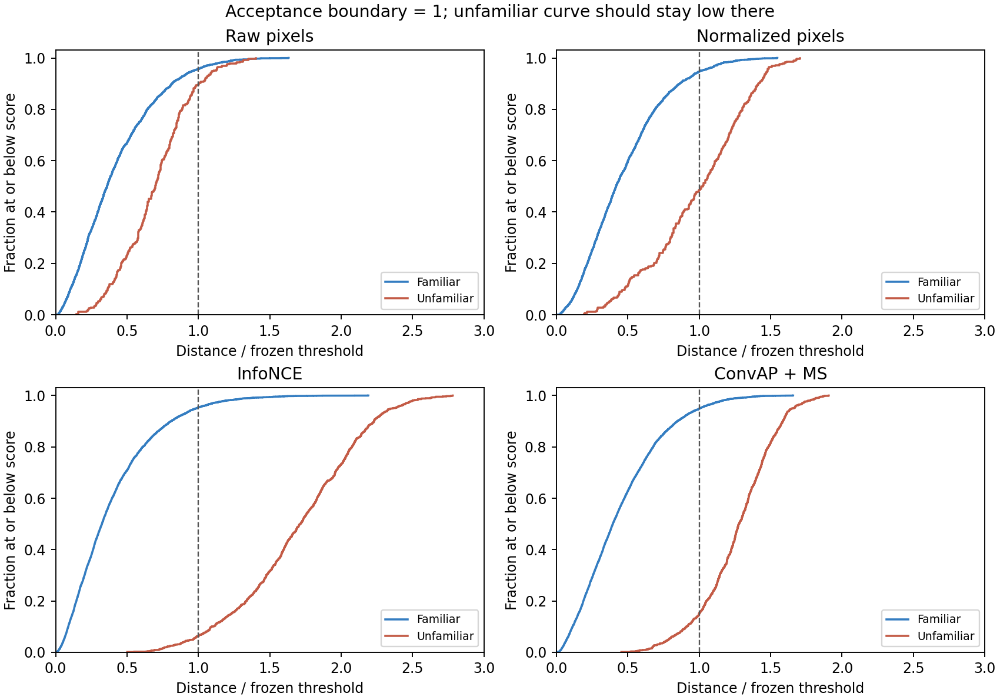

# Familiarity score diagnostics

Post-hoc analysis of the completed pilot's saved test scores. No models were fitted or scored again, and no deployed thresholds changed. Neural numbers average three training seeds.

| Method | Familiar accepted | Unfamiliar falsely accepted | Diagnostic FPR at 95% test TPR | AUROC | Clean-only AUROC | Median unfamiliar score / threshold |
| --- | ---: | ---: | ---: | ---: | ---: | ---: |
| Raw pixels | 95.75% | 89.58% | 86.81% | 0.781 | 0.906 | 0.70 |
| Normalized pixels | 94.70% | 48.61% | 48.96% | 0.866 | 0.907 | 1.02 |
| InfoNCE | 95.37% | 6.25% | 5.44% | 0.989 | 0.996 | 1.70 |
| ConvAP + MS | 94.94% | 15.05% | 15.28% | 0.972 | 0.990 | 1.28 |

The diagnostic ROC column uses test labels to describe a common operating point (at least 95% familiar acceptance, subject to sample discreteness). It is not a new calibrated threshold, an independent experiment, or a deployment recommendation. Published operating points remain unchanged. The gap persists when acceptance is equalized.

Each method has its own distance units. Dividing scores by that run's frozen threshold puts its acceptance boundary at 1; ratios are not calibrated probabilities. AUROC measures separation across thresholds, so different numerical distance scales alone cannot explain its gap.

| Condition | Raw false acceptance | Normalized | InfoNCE | ConvAP + MS |
| --- | ---: | ---: | ---: | ---: |
| clean | 98.61% | 58.33% | 7.41% | 22.69% |
| combined | 80.56% | 41.67% | 7.41% | 10.65% |
| exposure | 80.56% | 44.44% | 5.56% | 11.11% |
| occlusion | 98.61% | 50.00% | 4.63% | 15.74% |

Each condition contains 576 familiar and 72 unfamiliar test queries. Conditions use different query positions; condition differences do not isolate the causal effect of a perturbation. The clean-only AUROC gap shows that synthetic corruption is not the entire explanation.

See the [interpretation](../../FAMILIARITY.md).

Curves are empirical cumulative distributions. Neural curves equally mix runs after each run's threshold normalization; repeated scores across runs are not independent samples. The displayed score range is 0–3; larger scores are outside the panel.
